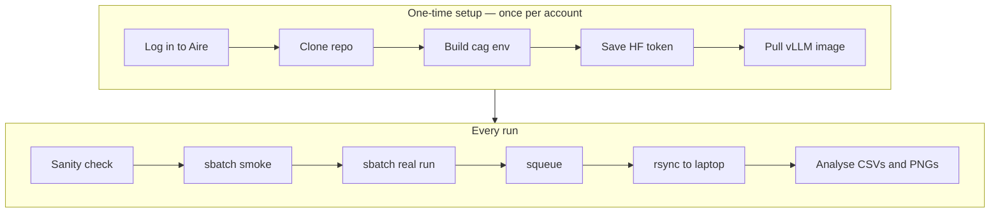

# Aire Quickstart — run Climate-Action-GABM on Leeds's HPC

A repo-specific, copy-pasteable recipe for running Climate-Action-GABM on Leeds's [Aire](https://arc.leeds.ac.uk/aire/) HPC: from a fresh account to a completed **smoke** job and a canonical **split50 Run-14**, then results back on your laptop.

For cited Leeds guidance, storage/data constraints, and the CAG launcher
contract, see [AIRE_HPC_repo_primer.md](AIRE_HPC_repo_primer.md).
This quickstart is the recipe; the primer is the reference.

**Review scope (2026-11-08).** Commands were checked against the repository
launcher and local CLI, not executed on Aire. Read the primer's
[sources and verification limits](AIRE_HPC_repo_primer.md#1-scope-sources-and-verification)
before using this recipe: Leeds is transitioning its HPC documentation during
an Aire upgrade. Confirm account access, data suitability, current resources,
and container/model compatibility with Research IT. Live timing estimates below
are historical, not guarantees.

---

## Golden path

If you've set up before, this is all you need. **🔧 = do once per Aire account · 🔁 = every run.** Section numbers point to the detail below.

```bash
# 🔧 ONE-TIME per Aire account (details in §§2–3)
ssh <you>@<aire-login-host>                                          # §2 (first-time login help linked there)
cd ~ && git clone git@github.com:compolis/Climate-Action-GABM.git && cd Climate-Action-GABM   # §3.3
module load miniforge && conda env create -f environment.yaml         # §3.4 — builds the `cag` env
mkdir -p ~/.cache/huggingface && read -rsp 'HF token: ' T && \
    (umask 077; touch ~/.cache/huggingface/token) && \
    chmod 600 ~/.cache/huggingface/token && \
    printf '%s' "$T" > ~/.cache/huggingface/token && \
    chmod 600 ~/.cache/huggingface/token && unset T                   # §3.5
cd ~ && module add apptainer && apptainer pull docker://vllm/vllm-openai:v0.8.5   # §3.6 — vLLM image
# Complete §3.7 to cache the chosen model before submitting.
```

```bash
# 🔁 EVERY run
cd ~/Climate-Action-GABM
mkdir -p "$SCRATCH/cag/slurm"
sbatch --output="$SCRATCH/cag/slurm/%x_%j.out" --error="$SCRATCH/cag/slurm/%x_%j.err" \
    scripts/aire/run.sh --preset smoke                              # §5 — cheap canary
sbatch --output="$SCRATCH/cag/slurm/%x_%j.out" --error="$SCRATCH/cag/slurm/%x_%j.err" \
    scripts/aire/run.sh --preset r14_canonical --exposure-targets split50   # §6
squeue --me                                                                    # §9 — watch it
# then, on your LAPTOP:
rsync -avP aire:/mnt/scratch/<user>/cag/runs/ ~/src/aire-runs/                  # §8 — pull results
```



<details>
<summary><strong>Jargon in 60 seconds</strong></summary>

- **`sbatch`** — submit a job to the Slurm queue; it returns a job id and runs when a GPU is free.
- **`squeue` / `scancel`** — list / cancel your queued jobs.
- **Slurm** — the scheduler that hands your job a GPU node.
- **`$SCRATCH`** — fast scratch storage on Aire (`/mnt/scratch/<user>`); runs are written here, not in your home dir.
- **SIF / apptainer** — a Singularity/Apptainer container image (`.sif`); we run vLLM inside one for reproducibility.
- **vLLM** — the server that hosts the LLM on the GPU node and answers the simulation's prompts.
- **SSH gateway / MFA** — offsite access uses an approved gateway or VPN route;
  obtain hosts and authentication steps from Leeds's account-specific guidance.
- **preset** — a named bundle of run settings (`smoke`, `r14_canonical`); `--preset NAME` applies it.
- **`cag`** — both the conda environment name and the Python package (`python -m cag`).
</details>

<details>
<summary><strong>Mac local-dev sidebar</strong> — most steps work locally too</summary>

On a Mac, start `mlx_lm.server --port 8080` with `mlx-community/Qwen3-8B-4bit`, then run `PYTHONPATH=src python -m cag --preset smoke --outdir data/output/smoke`. `SIM_CONFIG` defaults already point at `http://localhost:8080/v1`, so nothing else is needed. The rest of this guide assumes Aire.
</details>

---

## Table of contents

1. [Prerequisites](#1-prerequisites)
2. [SSH into Aire](#2-ssh-into-aire)
3. [One-time prep on Aire](#3-one-time-prep-on-aire)
4. [Free sanity checks (no GPU)](#4-free-sanity-checks-no-gpu)
5. [First sbatch — the smoke job](#5-first-sbatch--the-smoke-job)
6. [First real experiment — split50 Run-14](#6-first-real-experiment--split50-run-14)
7. [Reading the output](#7-reading-the-output)
8. [Pull results back to your laptop](#8-pull-results-back-to-your-laptop)
9. [Monitoring and cancelling jobs](#9-monitoring-and-cancelling-jobs)
10. [Resume a killed job](#10-resume-a-killed-job)
11. [Multi-job sweep](#11-multi-job-sweep)
12. [Common errors and fixes](#12-common-errors-and-fixes)
13. [Updating the repo on Aire later](#13-updating-the-repo-on-aire-later)
14. [Re-clone the repo from scratch](#14-re-clone-the-repo-from-scratch)
- [Appendix A. Flag reference](#appendix-a-flag-reference)
- [Cheat sheet](#cheat-sheet)

---

## 1. Prerequisites

| You need | Why | How |
| --- | --- | --- |
| An Aire account | To `ssh` and run jobs | Request via the Leeds RSE / ARC team (see [primer §1](AIRE_HPC_repo_primer.md)) |
| GitHub access to the repo | To `git clone` | Account with read access to `compolis/Climate-Action-GABM` |
| A Hugging Face account | To download the model weights | Free at <https://huggingface.co>; create a **read** token at *Settings → Access Tokens* |
| An SSH client locally | To reach Aire | macOS/Linux: built-in `ssh`. Windows: WSL or PuTTY. First-time login help in §2 |

If anything is missing, fix it before continuing. The rest of this guide assumes you can `ssh` into Aire.

---

## 2. SSH into Aire

From your laptop:

```bash
ssh <your-username>@<aire-login-host>
```

You should land in your `$HOME` on a login node. Everything below runs on Aire unless marked **(on your laptop)**.

> **First time connecting?** Start with Leeds's
> [public login page](https://arcdocs.leeds.ac.uk/aire/getting_started/logging_on.html),
> which links platform-specific instructions for Linux/Mac, Windows, gateway,
> and VPN access. Those articles **require a University login**; obtain your
> approved host/route from Leeds rather than guessing it.

> **Tip.** Use an SSH-config alias (§8) after checking your approved connection
> route. Authentication and gateway requirements remain those of the service.

**Next:** verify your shell is on Aire (`hostname` reports a login node), then continue to §3.

---

## 3. One-time prep on Aire

Do these once per Aire account. If you later re-clone the repo, you only repeat §3.3 (clone) and possibly §3.4 (env) — see §14.

> **⚠ Every new login shell needs `module load miniforge`.** Aire does **not** auto-load conda — in a fresh shell `conda activate cag` gives `conda: command not found` until you load the module. Same for `module add apptainer` before re-pulling the SIF. To make it automatic, append `module load miniforge` to `~/.bashrc`.

### 3.1 Move to your home directory

```bash
cd ~
```

### 3.2 Generate an SSH key and add it to GitHub

For SSH cloning, register a GitHub key on Aire. This key authenticates **to
GitHub**, not to the Aire login service; private repository access depends on
your GitHub permissions. Check for an existing key before generating one and
do not overwrite it. Use a passphrase and an agent where appropriate:

```bash
ssh-keygen -t ed25519 -C "you@example.com"
cat ~/.ssh/id_ed25519.pub                       # copy this whole line into GitHub
ssh -T git@github.com                           # expect: "Hi <user>! You've successfully authenticated"
```

Register the printed public key at GitHub → *Settings → SSH and GPG keys* (account-wide) **or** the repo's *Settings → Deploy keys* (repo-only; leave write access off). If `ssh -T` says `Permission denied (publickey)`, the key wasn't registered correctly.

<details>
<summary>Details — step-by-step, expected output, and the HTTPS-token alternative</summary>

**Step 1 — generate the key pair on Aire.** Choose an unused filename if a key
already exists, and follow University credential-protection advice. Do not
share or commit the private key.

```bash
ssh-keygen -t ed25519 -C "you@example.com"
```

You'll get:

```text
Your identification has been saved in /home/<user>/.ssh/id_ed25519
Your public key has been saved in /home/<user>/.ssh/id_ed25519.pub
```

**Step 2 — print the public key so you can copy it.**

```bash
cat ~/.ssh/id_ed25519.pub
```

Copy the **entire line** (starts with `ssh-ed25519`, ends with your email comment).

**Step 3 — register it with GitHub.** On your laptop browser:

- For account-wide access: <https://github.com/settings/keys> → *New SSH key* → paste → save.
- For repo-only access (deploy key): the repo's *Settings → Deploy keys → Add deploy key* → paste → save (leave write access off).

**Step 4 — verify from Aire.**

```bash
ssh -T git@github.com
```

Expected:

```text
Hi <your-github-username>! You've successfully authenticated, but GitHub does not provide shell access.
```

If you see "Permission denied (publickey).", the key wasn't registered correctly — go back to step 3.

**Alternative — HTTPS.** Use `git clone https://github.com/compolis/Climate-Action-GABM.git`.
If authentication is needed, use an approved credential helper or interactive
credential prompt with a narrowly scoped token. Never embed a token in the URL,
shell history, a script, or repository configuration.
</details>

### 3.3 Clone the repo

```bash
git clone git@github.com:compolis/Climate-Action-GABM.git
cd Climate-Action-GABM
```

<details>
<summary>Details — org repo vs. your fork, and using a non-default SSH key</summary>

**Org repo vs. your fork.** This clones the canonical **org** repo `compolis/Climate-Action-GABM` — the right choice for *running* canonical experiments on Aire, since you want the merged source of truth. If instead you are *developing code* and following the fork-based contributor flow ([DEV_QUICKSTART](../../DEV_QUICKSTART.md)), clone your own fork — `git@github.com:<your-github-username>/Climate-Action-GABM.git` — and add the org repo as `upstream` (`git remote add upstream git@github.com:compolis/Climate-Action-GABM.git`). Either way the SSH-key setup is identical, and `scripts/aire/run.sh` doesn't care which remote you cloned from.

**If your Aire key isn't the default `~/.ssh/id_ed25519`** (e.g. you keep a dedicated `~/.ssh/aire_repo`), the bare `git clone git@...` form won't pick it up. Use:

```bash
git clone -c core.sshCommand="ssh -i ~/.ssh/aire_repo -o IdentitiesOnly=yes" \
    git@github.com:compolis/Climate-Action-GABM.git
cd Climate-Action-GABM
git config core.sshCommand "ssh -i ~/.ssh/aire_repo -o IdentitiesOnly=yes"
```

The first command clones with the right key; the second persists it in `.git/config` so future `git pull`/`fetch` use the same key without flag soup. `IdentitiesOnly=yes` stops ssh from trying every other key in your agent first (which can trigger `Permission denied` on accounts with multiple GitHub identities).
</details>

### 3.4 Build the conda environment

```bash
module load miniforge
conda env create -f environment.yaml
```

This creates the `cag` simulation-client environment, including GABM 0.5.0;
vLLM runs separately in the container. The YAML does not install the Sphinx
documentation toolchain. Build times vary. Keep dependency manifests aligned;
update with `conda env update -f environment.yaml --prune` from the repo.

### 3.5 Hugging Face token

`scripts/aire/run.sh` uses `HF_TOKEN` first, otherwise
`${HF_HOME:-$HOME/.cache/huggingface}/token`. The default file survives logins.
Use a **read** token from <https://huggingface.co/settings/tokens>. Check the
chosen model's licence and access requirements; accept any gating agreement
if required. The launcher currently requires a token even for ungated models.

Write it (silent paste, no history leak), then verify:

```bash
mkdir -p ~/.cache/huggingface && \
    read -rsp 'Paste HF token: ' HF_TOKEN_VAL && \
    (umask 077; touch ~/.cache/huggingface/token) && \
    chmod 600 ~/.cache/huggingface/token && \
    printf '%s' "$HF_TOKEN_VAL" > ~/.cache/huggingface/token && \
    chmod 600 ~/.cache/huggingface/token && unset HF_TOKEN_VAL && echo

test -s ~/.cache/huggingface/token && echo "Non-empty token file present"
```

<details>
<summary>Details — why each flag, and the env-var / huggingface-cli alternatives</summary>

`read -rsp` reads silently; restrictive permissions are set before writing,
and `unset` clears the temporary shell variable. Do not print the token or
paste it into logs/chats. Non-empty is only a file check, not proof of token
validity; token lengths vary. Validate access through the model download.

**Alternative — environment variable.** Read it silently with
`read -rsp 'HF token: ' HF_TOKEN; export HF_TOKEN; echo`, then unset it when
finished. Do not save it in a tracked file or a literal shell-history command.

**Alternative — `huggingface-cli login`.** Writes the same file. Requires installing `huggingface_hub` (`pip install huggingface_hub` inside the `cag` env). Skip it unless you want the CLI for other reasons — the sim itself doesn't need it.
</details>

### 3.6 Pull the vLLM container

`scripts/aire/run.sh` defaults to `$HOME/vllm-openai-v0.8.5.sif` — pulled once,
then reused for compatible deployments. Pinned at `v0.8.5` for reproducibility.

```bash
cd ~
module add apptainer
apptainer pull docker://vllm/vllm-openai:v0.8.5
```

You'll get `vllm-openai-v0.8.5.sif` (~6 GB) in `$HOME`. The script finds it there by default; override with `SIF_IMAGE=/path/to/other.sif sbatch ...` if you put it elsewhere.

This is the launcher's pinned image, not a statement that v0.8.5 supports every
model or future cluster driver. Check compatibility and record the image digest
or checksum for research runs. Newer model architectures may require a different
validated image; changing `HF_MODEL` alone does not ensure compatibility.

For Apertus/Calder serving context, see the primer's
[related GABM guidance](AIRE_HPC_repo_primer.md#6-related-gabm-guidance-and-calder-portability).
Those historical multi-GPU settings are not a drop-in replacement for this
one-GPU Aire recipe.

### 3.7 Cache model weights before submitting

Avoid relying on a compute job to download weights: compute-node network access
was not verified in this review, and downloads consume the readiness timeout.
Follow Research IT's approved download route. If downloads/container execution
are permitted on the login node, use the same container/cache layout as the
launcher (no GPU inference is performed by this command):

```bash
module add apptainer
HF_MODEL="${HF_MODEL:-Qwen/Qwen3-14B}"
SIF_IMAGE="${SIF_IMAGE:-$HOME/vllm-openai-v0.8.5.sif}"
LOCAL_HF_CACHE="${LOCAL_HF_CACHE:-$SCRATCH/HF_cache}"
mkdir -p "$LOCAL_HF_CACHE"
HF_TOKEN="$(<"${HF_HOME:-$HOME/.cache/huggingface}/token")"
export APPTAINERENV_HF_TOKEN="$HF_TOKEN"
apptainer exec -B "$LOCAL_HF_CACHE:/root/.cache/huggingface" \
    --env HF_HOME=/root/.cache/huggingface "$SIF_IMAGE" \
    python -c 'import sys; from huggingface_hub import snapshot_download; snapshot_download(repo_id=sys.argv[1])' \
    "$HF_MODEL"
unset APPTAINERENV_HF_TOKEN HF_TOKEN
```

If you already supply `HF_TOKEN` through an approved environment mechanism,
omit the file-read line. Check the download exit status; do not submit after a
failed or interrupted download. For an alternative approved download tool,
ensure its cache is compatible with the container's `HF_HOME` binding.

**Next:** all one-time prep is done. Return to the repo (`cd ~/Climate-Action-GABM`) and continue to §4.

---

## 4. Free sanity checks (no GPU)

Confirm the environment and CLI before spending GPU time. These lightweight
checks do not call an LLM or execute a simulation; startup time varies:

```bash
cd ~/Climate-Action-GABM
module load miniforge && conda activate cag
PYTHONPATH=src python -m cag --list-presets            # lists smoke, r14_canonical, ...
PYTHONPATH=src python -m cag --preset smoke --dry-run  # resolves the final config as JSON, no LLM call
```

If both print sensible output, your env imports cleanly and the CLI is wired up.

> **Fresh login?** Run `module load miniforge` first, or `conda activate` reports `conda: command not found` (see the box in §3).

<details>
<summary>Example <code>--list-presets</code> output</summary>

```text
smoke
  Fast smoke-test run shape: 10 agents, 2 days, no peer messaging. ...
  config:
    n_citizens = 10
    days = 2
    k_peers_per_day = 0
    thinking = False

r14_canonical
  Run-14 baseline run shape: 50 agents, 5 days, ...
  config:
    n_citizens = 50
    days = 5
    ...
```
</details>

**Next:** submit the smoke sbatch (§5).

---

## 5. First sbatch — the smoke job

A 10-agent, 2-day run that exercises the basic server/client, surveys, CSV, and
plot path. It does not cover every branch: peer messaging is disabled. Use it
as a small canary before a real run.

```bash
cd ~/Climate-Action-GABM
sbatch scripts/aire/run.sh --preset smoke
# -> Submitted batch job 12345
```

Historical runtime estimate: **~5–15 min**, excluding queueing and model setup.
Pre-cache the model (§3.7); scheduled smoke validation is still required.

<details>
<summary>Which model it uses, and what <code>run.sh</code> actually does</summary>

**Which model does the smoke run use?** The `smoke` preset does **not** pin a model — it's a pure run-shape bundle. On Aire, `scripts/aire/run.sh` hardcodes `--model "$HF_MODEL"`, and `HF_MODEL` defaults to `Qwen/Qwen3-14B` (served by vLLM inside the SIF). To test a different model, prefix the sbatch line: `HF_MODEL=other/model sbatch scripts/aire/run.sh --preset smoke`.

**What the command does:**

- `scripts/aire/run.sh` starts vLLM on a job-derived port (or `PORT` override),
  waits for a successful chat completion for `HF_MODEL`, then runs
  `python -m cag` using that model/endpoint. `MAX_WAIT_SECONDS` defaults to 1500.
  Caller research flags are forwarded. Do not override the injected
  `--provider`, `--model`, `--base-url`, or `--outdir` through caller flags.
- Output goes to `$SCRATCH/cag/runs/run_<jobid>/`.
- With the golden-path `--output`/`--error` overrides, Slurm logs go to
  `$SCRATCH/cag/slurm`. Bare `sbatch` examples use the launcher's default logs
  in the submission directory; apply the same scratch-log overrides to them.
</details>

**Next:** monitor it (§9); once it finishes cleanly, go to §6.

---

## 6. First real experiment — split50 Run-14

Once the smoke succeeds, submit the canonical research run. Same `run.sh`, different flags.

```bash
sbatch scripts/aire/run.sh --preset r14_canonical --exposure-targets split50
```

| Token | What it does |
| --- | --- |
| `sbatch scripts/aire/run.sh` | Queue the Aire launcher script (vLLM bring-up + `python -m cag` + cleanup) |
| `--preset r14_canonical` | Apply the Run-14 baseline bundle (50 agents, 5 days, `k_peers_per_day=0`, `day0_anchor=ground_truth_with_rationale`, `thinking=False`, default `memory` preset; the Condition-B two-step survey is always on) |
| `--exposure-targets split50` | Pin the political-exposure mix to a `{A-only: 0.5, B-only: 0.5}` split (everyone gets exactly one side's broadcasts). The canonical persuasion test condition |

Historical wall-clock estimate: **~40–90 min** with Qwen3-14B, excluding queueing
and model setup. Validate timings on your current cluster/model combination.

> **Two independent limits.** Pre-cache weights (§3.7). If model initialisation
> still exceeds the 1500-second readiness limit, inspect the server log and,
> if justified, increase `MAX_WAIT_SECONDS`. A longer Slurm `--time` **does not**
> increase that readiness limit. Allocate enough wall-clock for both startup
> and simulation, subject to current partition limits.

```bash
MAX_WAIT_SECONDS=3000 sbatch --time=06:00:00 scripts/aire/run.sh \
    --preset r14_canonical --exposure-targets split50
```

Per-day checkpointing is on by default. A completed checkpoint may allow
continuation (§10); a kill before the first checkpoint or during a failing write
does not guarantee recoverable state, and exact replay has known limitations.

**The three flags you'll change most** (full list in [Appendix A](#appendix-a-flag-reference--every-sim_config-knob)):

| Flag | Sets |
| --- | --- |
| `--preset` | a whole run-shape bundle (`smoke`, `r14_canonical`) |
| `--exposure-targets` | who hears which side (`split50`, `neither`, or a JSON mix) |
| `--reach-a` / `--reach-b` | each side's audience fraction (reach-asymmetry experiments) |

<details>
<summary>Details — <code>--time</code> and other Slurm overrides, opting out of checkpoints</summary>

`--time` is an `sbatch` flag — it overrides the `#SBATCH --time` header inside the script. Any Slurm directive is overridable this way (`--mem=120G`, `--cpus-per-task=16`, ...). Pass `--no-checkpoint-every-day` to the Python CLI if you want to skip per-day checkpoints for a throwaway smoke test.
</details>

**Next:** while it runs, read §7.

---

## 7. Reading the output

Each run lands in `$SCRATCH/cag/runs/run_<jobid>/`. When a run finishes, check these four first:

1. **`run.log` final TIMING block** — simulation time, per-agent-day cost, no late crashes.
2. **`config.json`** — the exact resolved configuration (the run's fingerprint). If two runs disagree, diff their `config.json`s — that's the ground truth, not your sbatch line.
3. **`vllm_server.log` first ~50 lines** — confirms `Loading model 'Qwen/Qwen3-14B'` (or whatever you intended); catches the "asked for X, got Y" class of bugs.
4. **`opinion_trajectories.csv`** — non-empty, with columns `agent_id`, `day`,
   `policy_id`, `opinion`. For a completed fresh R14 run with Day-0 anchoring,
   expect `(5 + 1) × 50 × 6 = 1800` rows, 50 distinct `agent_id` values, and
   days 0 through 5. The five simulated days are 1-indexed; Day 0 is the anchor.

<details>
<summary>Core run-directory layout (not an exhaustive manifest)</summary>

```text
run_<jobid>/
├── run.log                          # full sim log; final TIMING block is the summary
├── vllm_server.log                  # server bring-up; first lines confirm which model loaded
├── config.json                      # exact resolved SIM_CONFIG (the run's fingerprint)
├── opinion_trajectories.csv         # per-(agent, day, policy) numeric opinion
├── package_index_trajectories.csv   # per-(agent, day) pro-climate index (package mode only)
├── opinion_shares.csv               # derived: % support over time, per policy
├── package_index_shares.csv         # derived: % support over time, package level
├── reflections.csv                  # internal monologue after each exposure event
├── messages.csv                     # every broadcast and peer message, sender→recipient
├── survey_reasoning.csv             # end-of-day survey rationale
├── survey_raw_response.csv          # raw LLM survey text (pre-parse)
├── daily_summaries.csv              # per-day per-agent compressed memory
├── ground_truth.csv                 # YouGov anchor values per (agent, policy)
├── package_ground_truth.csv         # YouGov anchor index (package mode only)
├── opinion_trajectories.png         # plot
├── package_index_trajectories.png   # plot
├── opinion_shares.png               # plot
├── package_index_shares.png         # plot
└── checkpoints/                     # after a completed checkpoint; default-on
    └── checkpoint_meta.json + per-day CSV dumps
```
</details>

For conditional files and exact schemas, use the maintained
[Run Output Guide](Run_Output_Guide.md), not this abbreviated listing.

**Next:** pull results to your laptop (§8), or compose your next experiment from [Appendix A](#appendix-a-flag-reference).

---

## 8. Pull results back to your laptop

> **⚠ Run this on your LAPTOP, not inside the Aire ssh session.** The destination path lives on your laptop; if you run `rsync` while still ssh'd into Aire you'll get `mkdir failed: No such file or directory`. Either `exit` the Aire shell first, or open a fresh terminal on your laptop.

**Mirror every run in one go** — the command to reuse day to day. `-avP` archives, prints a progress bar, and resumes partial transfers:

```bash
rsync -avP aire:/mnt/scratch/<user>/cag/runs/ ~/src/aire-runs/
```

- Replace `<user>` with your Leeds Aire username (run `whoami` on Aire if unsure — e.g. `vbwt265`).
- First run `echo "$SCRATCH"` on Aire and substitute that actual absolute path
  for `/mnt/scratch/<user>` in laptop commands; the path shown is a documented
  example, not an account lookup.
- Replace `~/src/aire-runs/` with wherever you keep runs on your laptop; `rsync` creates it if the parent exists.
- The `aire:` shorthand relies on the SSH-config alias below. Without it, use the full form `<user>@<aire-login-host>:/mnt/scratch/<user>/cag/runs/`.
- The trailing slash on `runs/` copies its *contents*, so each run lands as `~/src/aire-runs/run_<jobid>/`. Re-running is cheap — `rsync` only transfers what changed.

<details>
<summary>SSH-config alias — use the approved account connection route</summary>

Leeds documents direct access from the wired campus network and gateway or VPN
access offsite (including Eduroam). Obtain the exact hosts and authentication
steps from the University-only login articles (§2). This is a template, not a
verified host configuration:

```text
Host leeds-gateway
    HostName <approved-gateway-host>
    User <your-leeds-username>

Host aire
    HostName <approved-aire-login-host>
    User <your-leeds-username>
    ProxyJump leeds-gateway
```

Omit the gateway stanza and `ProxyJump` when your approved route is direct/VPN.
Do not assume SSH key login or MFA bypass is supported. SSH connection reuse
can reduce repeat prompts only where allowed by service policy; it does not
change authentication requirements.

After saving the config, every command shortens to `aire:/mnt/scratch/<user>/cag/runs/...`.
</details>

<details>
<summary>Filtered / single-run transfer (CSV / PNG / JSON / logs only), plus caveats</summary>

For a single run, append its folder: `.../cag/runs/run_<jobid>/ ~/src/aire-runs/run_<jobid>/`. To pull only CSVs / PNGs / JSON / logs:

```bash
LOCAL_DIR=~/cag_results/run_12345                          # on your laptop
REMOTE_DIR="aire:/mnt/scratch/<user>/cag/runs/run_12345"

mkdir -p "$LOCAL_DIR"
rsync -avh \
    --include='*/' \
    --include='*.csv' --include='*.png' --include='*.json' --include='*.log' \
    --exclude='*' \
    "$REMOTE_DIR"/ "$LOCAL_DIR"/
```

- **Use the literal remote path obtained from `echo "$SCRATCH"` on Aire.**
  Do not rely on the laptop's `$SCRATCH`, which is unset or unrelated.
- **`mkdir -p` first.** rsync creates the leaf directory but not its parents, so `~/cag_results/` must exist first or you'll get `mkdir failed`.
- **Trailing slash on `$REMOTE_DIR/`** copies the *contents* of the run dir into `$LOCAL_DIR`; drop it to nest the run dir inside instead.
- **Want the vLLM server log too?** It's already covered by `*.log`. To skip it explicitly, add `--exclude='vllm_server.log'`.
- **Off-campus / MFA:** rsync follows the same approved SSH route and
  authentication requirements as interactive access.
</details>

**Next:** open the CSVs in your notebook of choice (`notebooks/19_full_simulation.ipynb` is the canonical analysis pattern).

---

## 9. Monitoring and cancelling jobs

```bash
squeue --me                                  # all your queued/running jobs
squeue -j <jobid>                            # one job
tail -f "$SCRATCH/cag/slurm/LLM-cag-run_<jobid>.out"   # golden-path scratch logs
sacct -j <jobid> --format=JobID,State,Elapsed,MaxRSS,ExitCode   # post-mortem accounting
scancel <jobid>                              # cancel a job
```

<details>
<summary>More — inspect one job before cancellation and watch its GPU</summary>

```bash
# Inspect and cancel only the intended job:
squeue -j <jobid>
scancel <jobid>

# Tail that job's golden-path stdout:
tail -f "$SCRATCH/cag/slurm/LLM-cag-run_<jobid>.out"

# Track GPU utilisation on a running job (jump onto the node):
srun --jobid=<jobid> --pty nvidia-smi
```
</details>

For resource guidance, see [primer §4](AIRE_HPC_repo_primer.md#4-resource-requests-sweeps-and-reproducibility)
and its official Slurm links. With bare submissions, monitor logs in the
submission directory instead.

---

## 10. Resume a killed job

If a valid completed checkpoint exists, continuation can start after its
last completed day. Use the same run configuration and a directory under
scratch. Checkpointing defaults on, but **exact fresh-process replay is not
guaranteed**: the offline message cursor, peer RNG state, and prompt-log/timeline
hydration limitations are recorded in the
[refactor plan](../../GABM_Refactor_Plan.md). In particular, the default offline
message path has expected-failure continuation tests. Do not treat a resumed
run as scientifically equivalent without an appropriate equivalence check.

```bash
RESUME_FROM=$SCRATCH/cag/runs/run_<old_jobid> sbatch scripts/aire/run.sh \
    --preset r14_canonical \
    --exposure-targets split50
```

The new job writes back into the **same** `OUTDIR` (`$RESUME_FROM` — don't pass `--outdir`), forwards `--resume` automatically, and replays from `<outdir>/checkpoints/`.

<details>
<summary>Resume contract — which config keys must match (hard) vs. may change (soft)</summary>

Checked at startup, fails loudly on mismatch:

The authoritative hard/soft key lists and resolved network-parameter comparison
are in [checkpoint.py](../../src/cag/io/checkpoint.py). Hard keys include
persona mode, reach-targeting modes, and memory configuration as well as
population/exposure/message settings; mismatches abort. Tolerated transport
changes can still alter research results even when only a warning is emitted.

If you need to change a hard key, start a fresh run instead of resuming.
</details>

**Next:** for a planned multi-condition study, prefer §11.

---

## 11. Multi-job sweep

For ≥3 related jobs (different exposure targets, different reach values, etc.), use the sweep wrapper: one text file lists the per-job flag suffix on each line, the wrapper submits one `sbatch` per line.

The shipped example, [scripts/aire/sweeps/r14_v2.txt](../../scripts/aire/sweeps/r14_v2.txt):

```text
--preset r14_canonical --exposure-targets split50
--preset r14_canonical --exposure-targets neither
--preset r14_canonical --exposure-targets neither --day0-anchor llm_survey
```

Submit all three:

```bash
bash scripts/aire/sweep.sh scripts/aire/sweeps/r14_v2.txt
```

Each line becomes one `sbatch scripts/aire/run.sh <that line>`. The wrapper prints every submitted job ID and appends them to `<sweep_file>.log` for later cross-reference. Pass extra `sbatch` flags applied to **every** job after the file name:

```bash
bash scripts/aire/sweep.sh scripts/aire/sweeps/r14_v2.txt --time=06:00:00 --mem=120G
```

Use the golden-path scratch-log `--output` and `--error` overrides here too.
An optional `LABEL=<filename-safe-token>` prefix sets `RUN_LABEL` for one job.
These are separate jobs, not a Slurm array. The wrapper splits on whitespace
without shell quote interpretation: JSON inside a sweep file must be compact
and unquoted, unlike JSON passed directly from an interactive shell:

```text
LABEL=split50_s42 --preset r14_canonical --seed 42 --exposure-targets {"A-only":0.5,"B-only":0.5,"both":0,"neither":0}
```

<details>
<summary>When to use sweep vs. plain <code>sbatch</code>, and authoring a new sweep</summary>

- **Sweep is better:** ≥3 related jobs; you want a single artefact (the `.log`) recording the whole experiment grid; you want identical Slurm settings.
- **Plain sbatch is better:** one-off, or each job needs different Slurm settings.

To author a new sweep, drop a new `.txt` file under [scripts/aire/sweeps/](../../scripts/aire/sweeps/) — one line per job, `#` for comments. No code change.
</details>

**Next:** errors? §12.

---

## 12. Common errors and fixes

| Symptom (in `LLM-cag-run_<jobid>.err` or `.out`) | Cause | Fix |
| --- | --- | --- |
| `ERROR: HF_TOKEN is not set` | Token missing on this account or custom `HF_HOME` changed the lookup | Use the protected file or silently supplied environment variable (§3.5); do not print the token |
| `ERROR: vLLM container not found at: $HOME/vllm-openai-v0.8.5.sif` | Image not pulled, or in wrong place | Re-do §3.6, or `SIF_IMAGE=/your/path.sif sbatch ...` |
| `[wait] ERROR: server not ready after 1500s` | Missing weights, slow initialisation, or incompatible model/container | Inspect `vllm_server.log`, pre-cache weights (§3.7), validate compatibility; increase `MAX_WAIT_SECONDS` only if justified. `--time` alone does not fix this |
| `ERROR: src/cag not found under REPO_DIR=...` | You submitted `sbatch` from outside the repo | `cd ~/Climate-Action-GABM && sbatch ...` |
| `Cannot resume: config key 'X' changed` | You changed a hard key while passing `--resume` | Either revert the key, or start a fresh run (drop `--resume` and `RESUME_FROM`) |
| `ModuleNotFoundError: No module named 'cag'` | Conda env not activated, or `PYTHONPATH` not set | `conda activate cag`; for local invocations include `PYTHONPATH=src` |
| `error: missing required config key(s): ['n_citizens', 'days']` | You forgot both, and didn't pass a preset that supplies them | Add `--n-citizens N --days D` or `--preset smoke` |
| `Job exited 1 immediately, no run.log written` | Crash before logging started — check `LLM-cag-run_<jobid>.err` | Most often bad JSON in `--exposure-targets`, or a typo in a preset name (argparse rejects with exit 2) |

Anything else: open `LLM-cag-run_<jobid>.out` and search for `ERROR` from the bottom up.

---

## 13. Updating the repo on Aire later

The repo will change. To pull updates into your Aire clone:

```bash
cd ~/Climate-Action-GABM
git pull
```

If `environment.yaml` changed:

```bash
module load miniforge
conda env update -f environment.yaml --prune
```

If `scripts/aire/run.sh` mentions a newer vLLM image version, repeat §3.6 with that version. The previous SIF can be deleted (or kept side-by-side and selected with `SIF_IMAGE=...`). The conda env, the model weights cache (`$SCRATCH/HF_cache`), and the SIF live outside the repo tree — none of those need touching on a `git pull`.

---

## 14. Re-clone the repo from scratch

Sometimes a `git pull` (§13) isn't enough — a rebased or force-pushed history, a wedged working tree, or you just want a clean slate. This **backs up** the old clone rather than deleting it (in case you left uncommitted run configs or notes in there), clones fresh, then re-points at the conda env and Hugging Face token — both of which live **outside** the repo tree and survive untouched.

> **What survives a reclone (all outside `~/Climate-Action-GABM`):** the `cag` conda env, the model weights cache (`$SCRATCH/HF_cache`), the vLLM `.sif` container, and the HF token file (`~/.cache/huggingface/token`). You normally only re-verify these, not rebuild them.

> **SSH key note.** The commands below use a dedicated deploy key `~/.ssh/aire_repo` (see [§3.2](#32-generate-an-ssh-key-and-add-it-to-github)). That key must be registered on **`compolis/Climate-Action-GABM`** — as a repo *deploy key* or an SSH key on your GitHub account. If it was only ever added to a personal fork, add it to the org repo (or your account) first, otherwise the clone fails with `Permission denied (publickey)`. If you instead rely on the default `~/.ssh/id_ed25519`, drop the `-c core.sshCommand=...` prefix from Step 2.

**Step 1 — back up the old clone (don't delete it outright).**

```bash
cd ~
mv Climate-Action-GABM "Climate-Action-GABM.bak.$(date +%Y%m%d_%H%M%S)"
ls -d Climate-Action-GABM*
```

Renames the checkout to a timestamped backup and lists matches so you can
confirm. Stop if the move fails. After the fresh clone works, inspect the
specific backup for uncommitted work before removing that exact directory;
do not use wildcard deletion of all backups.

**Step 2 — fresh clone (with the Aire deploy key).**

```bash
cd ~ && git clone -c core.sshCommand="ssh -i ~/.ssh/aire_repo -o IdentitiesOnly=yes" git@github.com:compolis/Climate-Action-GABM.git && cd Climate-Action-GABM && git log --oneline -3
```

`git log --oneline -3` prints the three most recent commits so you can eyeball the history. **Persist the key** so future `git pull`/`fetch` don't need the flag:

```bash
git config core.sshCommand "ssh -i ~/.ssh/aire_repo -o IdentitiesOnly=yes"
```

**Step 3 — load conda, confirm the env exists, then activate.**

```bash
module load miniforge && conda env list | grep -E '^cag\s' && conda activate cag && which python
```

`which python` should point inside `.../envs/cag/bin/python`. If the env is **missing** (e.g. a brand-new account), build it once with [§3.4](#34-build-the-conda-environment): `conda env create -f environment.yaml`.

**Step 4 — verify the Hugging Face token (rewrite only if wrong).**

```bash
[[ -r ~/.cache/huggingface/token ]] && echo "token file present, $(wc -c < ~/.cache/huggingface/token) bytes" || echo "NOT SET"
```

The token file survives a reclone, so usually you just check it. If it's missing or wrong, rewrite it with the command in [§3.5](#35-hugging-face-token).

**Next:** you're back to a working clone. Run the free sanity checks in [§4](#4-free-sanity-checks-no-gpu) before submitting any job.

---

(appendix-a-flag-reference--every-sim_config-knob)=
## Appendix A. Flag reference

Use the maintained [Simulation Configuration Guide](Simulation_Configuration_Guide.md)
for research settings and the current checkout's CLI for exact supported flags:

```bash
PYTHONPATH=src python -m cag --help
PYTHONPATH=src python -m cag --preset r14_canonical --exposure-targets split50 --dry-run
```

This replaces the duplicated, incomplete default-value tables. Configuration
precedence is `SIM_CONFIG`, then a preset, then CLI overrides. A preset is
convenient, not a prerequisite for a new experiment. Preserve the resolved
`config.json` and source/environment/container versions with results.

The launcher serves one model: set `HF_MODEL` to select it. Do not pass
`--model`, `--provider`, `--base-url`, or `--outdir` as caller overrides through
`sbatch`. A different `--survey-model` is not automatically hosted by this server.
For ports, image/cache choices, readiness timeouts, labels, and resume, see the
[launcher contract](AIRE_HPC_repo_primer.md#3-current-launcher-contract) and §10.

### Worked examples

```bash
# Reach-asymmetry sweep with a longer wall-clock (checkpoints default-on):
sbatch --time=06:00:00 scripts/aire/run.sh \
    --preset r14_canonical \
    --exposure-targets split50 \
    --reach-a 0.5 --reach-b 1.0

# Bypass the offline message pool and have the LLM generate political text:
sbatch scripts/aire/run.sh \
    --preset r14_canonical \
    --exposure-targets split50 \
    --message-source llm

# Inline JSON for a one-off exposure mix (no preset name needed):
sbatch scripts/aire/run.sh \
    --preset r14_canonical \
    --exposure-targets '{"A-only":0.4,"B-only":0.4,"both":0.1,"neither":0.1}'

# Memory ablation — drop the Day-0 anchor to test how much it pins opinions
# (compare against the same run with --memory default):
sbatch scripts/aire/run.sh \
    --preset r14_canonical \
    --exposure-targets split50 \
    --memory no_anchor

# Hand-tuned memory — widen the verbatim window and hide the anchor at survey
# time only (inline JSON):
sbatch scripts/aire/run.sh \
    --preset r14_canonical \
    --exposure-targets split50 \
    --memory '{"verbatim_window_days":3,"stages":{"survey":{"day0_anchor":{"enabled":false}}}}'

# Peer fan-out — let well-connected citizens relay wider ("influentials"). The
# default additive budget grows total peer talk as connectivity rises (realistic
# posting-network model); --peer-fanout-kmax caps how far even the biggest hub goes:
sbatch scripts/aire/run.sh \
    --preset r14_canonical \
    --exposure-targets split50 \
    --k-peers 2 --peer-fanout-mode degree --peer-fanout-budget additive --peer-fanout-kmax 10
```

The exact memory config each job used is printed on the startup `[memory]` line in `run.log` and stored in `config.json → memory_resolved`, so ablation variants are always auditable after the fact. **Composing a new experiment is just a new `sbatch` line — no script edit, no commit.**

---

## Cheat sheet

```bash
# Free sanity checks (login node, no GPU):
PYTHONPATH=src python -m cag --list-presets
PYTHONPATH=src python -m cag --preset smoke --dry-run

# Smoke job (cheap full-stack canary):
sbatch scripts/aire/run.sh --preset smoke

# Canonical split50 Run-14:
sbatch scripts/aire/run.sh --preset r14_canonical --exposure-targets split50

# Same run, longer wall-clock + per-day checkpointing:
sbatch --time=06:00:00 scripts/aire/run.sh --preset r14_canonical --exposure-targets split50 --checkpoint-every-day

# Historical 2026-07-02 submission examples (not the current canonical preset)
sbatch --time=06:00:00 scripts/aire/run.sh \
    --n-citizens 50 --days 5 --k-peers 2 --seed 42 \
    --exposure-targets '{"A-only":0.05,"B-only":0.05,"both":0.60,"neither":0.30}' \
    --reach-a 1.0 --reach-b 1.0 \
    --memory '{"persona":{"enabled":true},"day0_anchor":{"enabled":true,"ttl_days":1},"daily_summaries":{"enabled":true},"recent_reflections":{"enabled":true},"own_reasoning":{"enabled":true},"today_so_far":{"enabled":true},"opinion_trajectory":{"enabled":false},"verbatim_window_days":2,"stages":{"peer_message":{},"reflection":{},"survey":{}}}'

sbatch --time=06:00:00 scripts/aire/run.sh \
    --n-citizens 50 --days 5 --k-peers 2 --seed 42 \
    --exposure-targets '{"A-only":0.05,"B-only":0.05,"both":0.60,"neither":0.30}' \
    --reach-a 1.0 --reach-b 1.0 \
    --network-type erdos_renyi \
    --network-params '{"p":0.10}' \
    --memory '{"persona":{"enabled":true},"day0_anchor":{"enabled":true,"ttl_days":1},"daily_summaries":{"enabled":true},"recent_reflections":{"enabled":true},"own_reasoning":{"enabled":true},"today_so_far":{"enabled":true},"opinion_trajectory":{"enabled":false},"verbatim_window_days":2,"stages":{"peer_message":{},"reflection":{},"survey":{}}}'

# Resume a killed run (same OUTDIR, same hard keys):
RESUME_FROM=$SCRATCH/cag/runs/run_<old_jobid> sbatch scripts/aire/run.sh --preset r14_canonical --exposure-targets split50

# Multi-job sweep from a one-line-per-job text file:
bash scripts/aire/sweep.sh scripts/aire/sweeps/r14_v2.txt

# Monitoring:
squeue --me
tail -f "$SCRATCH/cag/slurm/LLM-cag-run_<jobid>.out"
sacct -j <jobid> --format=JobID,State,Elapsed,MaxRSS,ExitCode

# Pull results back (on your laptop, NOT inside the Aire ssh session):
rsync -avP aire:/mnt/scratch/<user>/cag/runs/ ~/src/aire-runs/
```

When in doubt: `--dry-run` first, then commit GPU time.
